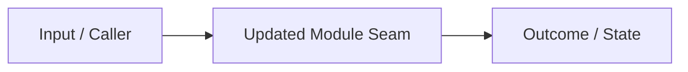

## Summary

<1–3 sentences stating what changed and why>

## Blast Radius & Door Type

- **Door Type**: Two-Way Door (revertible) | One-Way Door (irreversible migration/contract)
- **Affected Modules & Callers**: List impacted modules and public seams.

## Security & Data Impact

- **Auth / Authz Changes**: <none | object-level checks added or changed>
- **Secrets & Credentials**: <none | removal/rotation plan; never paste the value>
- **Data Exposure / Migrations**: <none | affected tables, backfills, rollback path>
- **New Dependencies**: <none | `package@exact-version`, why it is needed, lockfile updated>

## Evidence (Before & After)

- **Before**: `<previous behavior or failing test output>`
- **After**: `<verified test command and passing output>`
