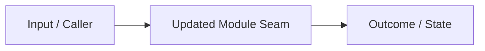

## Summary

<1–3 sentences stating what changed and why>

## Blast Radius & Door Type

- **Door Type**: Two-Way Door (revertible) | One-Way Door (irreversible migration/contract)
- **Affected Modules & Callers**: List impacted modules and public seams.

## Evidence (Before & After)

- **Before**: `<previous behavior or failing test output>`
- **After**: `<verified test command and passing output>`
