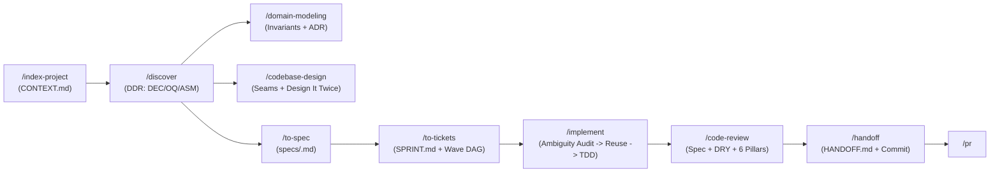

<div align="center">


# Antigravity Agent Core (AAC)

**Rules, multi-language skills, sandboxed subagents, and lifecycle hooks for Google Antigravity.**

<p align="center">
  <a href="CHANGELOG.md"></a>
  <a href="https://antigravity.google/docs"></a>
  <a href="LICENSE"></a>
</p>

</div>

---

## Overview

Out-of-the-box coding agents often assume missing requirements on vague tickets, duplicate existing UI components or helpers, hallucinate imports without reading files, and stop before running real verification suites.

**Antigravity Agent Core (`@rafaelghif/aac-core`)** installs a structured `.agents/` configuration layer and `AGENTS.md` / `CONTEXT.md` contract into any repository to enforce:

- **Ambiguity Gating Before Coding**: Audits prompts, PRDs, and tickets across scope, auth/tenancy, edge cases, API contracts, UI states, and codebase conflicts—stopping to call `ask_question` rather than guessing defaults.
- **Codebase Indexing & DRY Reuse**: Maps existing stack commands, config/logging seams, UI primitives/widgets, design tokens, and shared utilities into `CONTEXT.md` via `/index-project` (`scan-repo.mjs`), and auto-loads `glob`-scoped reuse rules when editing UI or application code.
- **Multi-Language Coverage**: Supports **TypeScript/JavaScript**, **Dart/Flutter**, **Go**, **Python**, **Rust**, **JVM**, and **Swift** across rules, test patterns, and the `Stop` quality-gate hook.
- **Runtime Guardrails**: Node-based lifecycle hooks (`SessionStart`, `PreToolUse`, `Stop`) block unconfirmed pushes to `main`/`master`, flag hardcoded credential literals or production mocks/stubs, and re-run the project test suite before allowing completion.
- **Non-Destructive CLI Management**: Installs, upgrades, and uninstalls via a SHA-256 manifest (`.agents/.aac-manifest.json`), backing up conflicts to `.scratch/backups/` and preserving `CONTEXT.md` and user edits.

---

## Quick Start

**Prerequisite**: Node.js **>= 22** on `PATH` (required by the CLI and lifecycle hooks).

### Option 1: NPX (Recommended)

```bash
# Install into the current repository
npx @rafaelghif/aac-core init

# Install into a specific path
npx @rafaelghif/aac-core init --target /path/to/project

# Preview planned changes without writing files
npx @rafaelghif/aac-core upgrade --dry-run

# Non-destructive upgrade (preserves CONTEXT.md, custom hooks, and local edits; stages conflicts as *.aac-new)
npx @rafaelghif/aac-core upgrade

# Force overwrite modified managed files (creates backups under .scratch/backups/)
npx @rafaelghif/aac-core upgrade --force

# Remove unmodified managed files (preserves CONTEXT.md and user modifications)
npx @rafaelghif/aac-core uninstall
```

### Option 2: Shell / PowerShell Installers

Both installers resolve `bin/cli.mjs` and delegate all file writes to it:

```bash
# Linux / macOS (download, inspect, then run)
curl -fsSL -o install.sh https://raw.githubusercontent.com/rafaelghif/antigravity-agents-core/v6.3.0/install.sh
less install.sh
bash install.sh [target_dir] [--upgrade] [--dry-run]
```

```powershell
# Windows PowerShell (download, inspect, then run)
Invoke-WebRequest -Uri https://raw.githubusercontent.com/rafaelghif/antigravity-agents-core/v6.3.0/install.ps1 -OutFile install.ps1
notepad install.ps1
powershell -NoProfile -File .\install.ps1 [-TargetDir "C:\path\to\project"] [-Upgrade] [-DryRun]
```

### Optional: Antigravity App Scheduled Sidecar (`--with-sidecar`)

> Supported on **Antigravity App only**. Requires `--project-id <id>`, writes `~/.gemini/config/config.json`, and consumes AI credits when scheduled runs execute.

```bash
npx @rafaelghif/aac-core init --with-sidecar --project-id "<your-antigravity-project-id>"
```

---

## What Gets Installed

### 1. Constitution & Project Index

- **`AGENTS.md`** (~9.7 KB, safely below Antigravity's 24 KB per-file cap): Always-on execution contract covering the 7-dimension Ambiguity Gate, Read-Before-Cite, Pre-Creation DRY Search, live `search_web` freshness, configurability, structured logging, secret hygiene, closed-loop test verification, and 2-strike/3-strike circuit breakers.
- **`CONTEXT.md`**: Living codebase index (verified commands, config/logging seams, UI primitives, shared utilities, module boundaries) plus domain invariants (`INV-###`), state machines (`ST-###`), quality targets (`NFR-###`), and error codes (`ERR-###`). Preserved on upgrade and uninstall.

### 2. Modular Rules (`.agents/rules/`)

| Rule | Trigger | Scope & Purpose |
| :--- | :--- | :--- |
| [`ui-and-dry.md`](.agents/rules/ui-and-dry.md) | `glob` | Web & mobile UI (`*.tsx`, `*.jsx`, `*.vue`, `*.svelte`, `*.css`, `*.dart`, `**/widgets/**`, `**/components/**`): primitive discovery, `Reuse → Extend → Compose → Create`, tokens, UI state matrix, disposal, rebuild optimization. |
| [`coding-standards.md`](.agents/rules/coding-standards.md) | `glob` | Multi-language source files (`TS/JS`, `Dart`, `Go`, `Python`, `Rust`, `Java/Kotlin`, `Swift`): startup-validated config, structured logging (`<REDACTED>`), N+1/memory/CPU optimization, boundary parsing, sum types, UTC/minor-unit currency. |
| [`database-migrations.md`](.agents/rules/database-migrations.md) | `glob` | SQL & migration files: lock/statement timeouts, `CREATE INDEX CONCURRENTLY` outside transactions, `NOT VALID` FKs, Expand-Migrate-Contract, parameterized tenant-scoped queries. |
| [`testing.md`](.agents/rules/testing.md) | `glob` | Test files (`*.test.*`, `*.spec.*`, `*_test.dart`, `*_test.go`, `*_test.py`, `integration_test/`): public-seam assertions, hermetic isolation, boundary matrix, anti-test-tampering. |
| [`security-and-auth.md`](.agents/rules/security-and-auth.md) | `model_decision` | BOLA/IDOR tenant scoping, fail-closed auth, constant-time secret comparison, prototype-pollution defense, TOCTOU locks, fencing tokens, SSRF + DNS pinning, path canonicalization. |
| [`architecture-and-flow.md`](.agents/rules/architecture-and-flow.md) | `model_decision` | User-defined topology (no unrequested monorepos/aliases), deep modules, external I/O seams, timeouts/retries, blast-radius caller tracing. |
| [`git-and-context.md`](.agents/rules/git-and-context.md) | `model_decision` | Conventional Commits, commit/push consent, `CONTEXT.md`, ADRs, DDRs, cross-machine `docs/sprint/HANDOFF.md`. |
| [`release-audit.md`](.agents/rules/release-audit.md) | `manual` | Pre-release checklist (`@`-mention in Antigravity App/IDE). |

### 3. Workflow Skills (`.agents/skills/`)



| Category | Skills | Helper Scripts (`--help`) |
| :--- | :--- | :--- |
| **Indexing & Discovery** | `/index-project`, `/discover` (pairs with built-in `/grill-me`), `/domain-modeling`, `/codebase-design`, `/research` | [`scan-repo.mjs`](.agents/skills/index-project/scripts/scan-repo.mjs) |
| **Planning & Execution** | `/to-spec`, `/to-tickets`, `/implement`, `/tdd`, `/safe-refactor`, `/database-migration`, `/diagnosing-bugs` | [`validate-spec.mjs`](.agents/skills/to-spec/scripts/validate-spec.mjs), [`validate-board.mjs`](.agents/skills/to-tickets/scripts/validate-board.mjs), [`audit-diff.mjs`](.agents/skills/implement/scripts/audit-diff.mjs) |
| **Review, Handover & Automation** | `/code-review`, `/handoff`, `/pr`, `/browsing`, `/office` | [`run-browser.mjs`](.agents/skills/browsing/scripts/run-browser.mjs), [`extract-office.py`](.agents/skills/office/scripts/extract-office.py) |

### 4. Subagents (`.agents/agents/`) & Lifecycle Hooks (`.agents/hooks.json`)

- **Subagents** (`commandExecutionPolicy: sandbox`):
  - `codebase-investigator` (`flash`): Maps tech stacks, shared UI/utilities, execution flows, and callers.
  - `adversarial-reviewer` (`inherit`): Audits diffs for spec fidelity, DRY/UI reuse, security, performance, and test integrity.
  - `verification-runner` (`flash`): Executes build, typecheck, lint, and test suites and returns compact failure traces.
- **Lifecycle Hooks** (cross-platform Node commands; documented threat model in [SECURITY.md](SECURITY.md)):
  - `SessionStart`: Surfaces `.scratch/handoff.md`, `docs/sprint/HANDOFF.md`, `docs/sprint/SPRINT.md`, or `CONTEXT.md` (prompting `/index-project` if `CONTEXT.md` is still a template), and supports `AAC_PERSONA=neutral`.
  - `PreToolUse` (`run_command`): Intercepts direct pushes to `main`/`master` via `.agents/git-guard.cjs` (`decision: "ask"`).
  - `PreToolUse` (file writes): Intercepts mock/dummy/TODO placeholders and credential literals in production paths, plus test-skipping/tautological assertions in test files (`decision: "ask"`).
  - `Stop` (`NO_TOOL_CALL` / `MAX_INVOCATIONS`, guarded by `continuationActive`): Checks modified/untracked test files for test tampering and runs the detected project test command (`package.json`, `pubspec.yaml`, `Cargo.toml`, `go.mod`, `pyproject.toml`, `Package.swift`, `mix.exs`) before allowing completion.

---

## Verification & CI Contract

All package contracts, CLI install/upgrade/uninstall safety, hook bypass/tamper cases, frontmatter limits, skill scripts, and markdown links are verified by the automated test suite on `ubuntu-latest`, `macos-latest`, and `windows-latest` (Node 22+):

```bash
npm test            # CLI, hooks, frontmatter, AGENTS.md size cap, skill scripts, link integrity
npm run pack:check  # Verify npm tarball contents
```

---

## Acknowledgements

- **[Matt Pocock](https://github.com/mattpocock)** ([`mattpocock/skills`](https://github.com/mattpocock/skills)): Inspiration for interview-first discovery and vertical slice workflows.
- **John Ousterhout** (*A Philosophy of Software Design*): Deep modules and narrow interface design.
- **Michael Feathers** (*Working Effectively with Legacy Code*): Public boundary seams and characterization testing.

## License

MIT — see [LICENSE](LICENSE).
