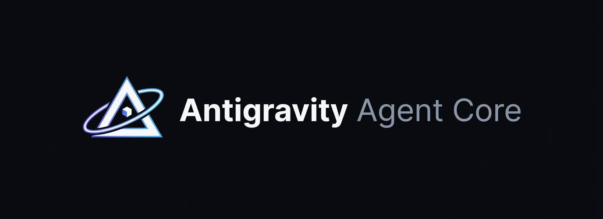
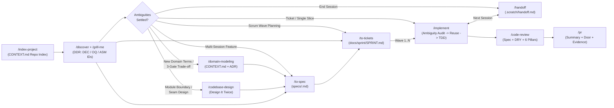

<div align="center">



# Antigravity Agent Core (V6)

**LLM-native Principal Software Engineering & Technical Scrum constitution, glob-scoped rules, codebase-indexed skills, sandboxed subagents, cross-platform lifecycle hooks, and zero-daemon MCP integration for Google Antigravity.**

<p align="center">
  <a href="CHANGELOG.md"></a>
  <a href="https://antigravity.google/docs"></a>
  <a href="https://antigravity.google/docs/rules"></a>
  <a href="#v5--v6-evolution--consolidation-matrix"></a>
  <a href="LICENSE"></a>
</p>

</div>

---

## Why Antigravity Agent Core?

Most AI coding assistants act as **sycophantic yes-men**: they agree with broken architectural premises, generate fragile, mock-heavy boilerplate, silently drop state across multi-turn sessions, and fail under complex enterprise constraints.

**Antigravity Agent Core (AAC V6)** upgrades Google Antigravity into an **uncompromising, LLM-native Principal Software Engineer & Technical Scrum Master**:

- **Anti-Yes-Man & Ambiguity Stop Gate**: Audits prompts, PRDs, and tickets before coding; challenges flawed premises (`[Premise Flaw] -> [Production Failure Mode] -> [Concrete Alternative]`) and halts with `ask_question` whenever requirements, UI states, auth rules, or API contracts are unclear.
- **Codebase Indexing & Shared UI / DRY Enforcement**: Indexes real repositories into `CONTEXT.md` (`/index-project`) and enforces `Reuse → Extend → Compose → Create` via `glob`-activated `ui-and-dry.md` and `coding-standards.md` rules.
- **The 6 Engineering Pillars**: Stress-tests every architectural decision and diff to be *Future-Proof, Scalable, Maintainable, Secure, High-Performance, and Upgradeable*.
- **Codebase-Grounded Technical Scrum**: Decomposes specs into an Execution Wave DAG (`docs/sprint/SPRINT.md`) and vertical tickets citing real `path:symbol` reusable assets and `DEC-###` provenance.
- **Zero-Mock Production Integrity & Closed-Loop Stop Gate**: Production paths require genuine environment-backed drivers; mocks/tampered tests are blocked by `PreToolUse` and `Stop` (`NO_TOOL_CALL`) hooks.
- **Zero-Daemon Primitives & Non-Destructive CLI**: Node stdio MCP + SHA-256 manifest CLI (`bin/cli.mjs`) protecting user edits.

---

## Core Design Principles (V6 Enterprise Architecture)

1. **LLM-Native Anti-Yes-Man Posture**: Direct, clinical, strictly non-sycophantic engineering execution. Audits prompts, PRDs, and tickets before writing code and stops with `ask_question` whenever requirements, UI states, auth rules, or API contracts are ambiguous.
2. **Codebase Indexing & Zero-Duplication (`CONTEXT.md` + `ui-and-dry.md`)**: Maps real project stack, commands, shared UI primitives, tokens, utilities, and module seams via `/index-project`, enforcing `Reuse → Extend → Compose → Create` via `glob`-scoped rules.
3. **The 6 Non-Negotiable Engineering Pillars**: Every design and diff is stress-tested against:
   - **Future-Proof**: Clean contracts, extensible domain models, zero hard-coded assumptions requiring rewrites.
   - **Scalable**: Zero N+1 query loops, bounded memory/queues, horizontal readiness, safe concurrency under load.
   - **Maintainable**: Low cognitive load (KISS, DRY, YAGNI, SOLID), deep modules (Ousterhout), intention-revealing names, zero clever spaghetti.
   - **Secure**: Zero-trust boundary parsing ("Parse, don't validate"), strict authorization (zero BOLA/IDOR), atomic mutations (zero TOCTOU races), zero leaked secrets.
   - **High-Performance**: Optimal algorithmic complexity, minimal I/O round-trips, proper indexing, explicit timeouts on external calls.
   - **Upgradeable**: Narrow boundary seams, backward-compatible migrations (`Expand-Migrate-Contract`), explicit `// ponytail:` upgrade paths.
4. **Grounded Discovery-to-Delivery Pipeline**:
   - Every artifact is production-bound unless explicitly labeled a throwaway spike. "MVP" means the smallest **complete, deployable, production-safe** slice.
   - `/discover` (pairing with built-in `/grill-me`) writes a `docs/discovery/<slug>.md` Discovery Decision Record with stable `DEC/OQ/ASM` IDs.
   - `/to-spec` and `/to-tickets` ground specs and vertical tickets in real codebase assets (`path:symbol`) without forcing fake filler on inapplicable gates, while `/implement` runs a mandatory Ambiguity & Reuse Audit before writing tests or code.
5. **Expert Technical Scrum & Multi-Session Continuity**:
   - `/to-tickets` generates a committed **Scrum Sprint Wave Board (`docs/sprint/SPRINT.md`)** and session-sized vertical tracer-bullet tickets (`docs/sprint/tickets/<NN>-<slug>.md`) with **Definition of Ready (DoR)**, **Execution Waves (DAG)**, **traceability matrix**, and **enterprise Definition of Done (DoD)**.
   - `/implement` executes 1 unblocked ticket test-first, commits atomically when the user authorizes commits, updates the ticket's `Session Handover & Completion Log`, and promotes newly unblocked tickets in `docs/sprint/SPRINT.md`.
   - `/handoff` checkpoints sprint progress, downstream seam notes, and the exact next command into `.scratch/handoff.md`.
6. **Cross-Platform Lifecycle Hooks & Standalone Guards**:
   - `.agents/hooks.json` uses cross-platform Node JSON parsers:
     - `SessionStart`: Detects cold-start sprint/handoff artifacts, flags unindexed template `CONTEXT.md` files, and injects active persona directives.
     - `PreToolUse` (Git Guard): Loads `.agents/git-guard.cjs` to intercept direct pushes to protected `main` or `master` branches with `decision: "ask"`, while keeping everyday dev commands (branch, commit, stash, checkout) frictionless.
     - `PreToolUse` (Production No-Mock Guard): Blocks dummy IDs/tokens, synthetic stores, and deferred `TODO` stubs in production paths, plus test-tampering patterns in test files.
     - `Stop` (Quality Gate Sensor): Intercepts `NO_TOOL_CALL` / `MAX_INVOCATIONS` (with `continuationActive` loop guard) to verify test integrity and run the repo test suite before allowing completion.
7. **Contained Sandboxed Subagents**:
   - `.agents/agents/*.md` subagents run with `commandExecutionPolicy: sandbox` using surface-compatible Antigravity tools without polluting the parent conversation context.
8. **Zero-Daemon MCP & Safe Platform Runtimes**:
   - Default configurations use native Node stdio (`@modelcontextprotocol/server-github`) reading credentials from `env` or `.agents/mcp.env`, eliminating background Docker daemon dependencies and Windows named-pipe failures.
9. **Non-Destructive SHA-256 Manifest CLI**:
   - Tracks managed files in `.agents/.aac-manifest.json`.
   - `upgrade` preserves `CONTEXT.md` and never overwrites user-modified files unless `--force` is passed (backs up conflicts to `.scratch/backups/<timestamp>/` and writes incoming updates to `<file>.aac-new`).

---

## V5 → V6 Evolution & Consolidation Matrix

AAC V6 consolidates 64 legacy fragmented skills into an LLM-native, deep-module architecture, eliminating cognitive noise, redundant variants, and token bloat while upgrading core engineering workflows:

| Legacy V5 Area (64 Skills Bloat) | V6 Consolidated Architecture | Primary Seams & Purpose |
| :--- | :--- | :--- |
| **Caveman Suite** (14 fragmented skills) | **LLM-Native `AGENTS.md` (<10 KB)** | Zero-fluff, deterministic anti-yes-man and verification contracts without human prose bloat or truncation. |
| **Ponytail Suite** (6 fragmented skills) | **Glob Rules (`ui-and-dry.md`, `coding-standards.md`)** | Automatic pre-edit discovery, `Reuse → Extend → Compose → Create`, caller mapping, and surgical edits. |
| **Grilling Variants** (3 skills) | **`/discover` + `/index-project`** | Codebase indexing into `CONTEXT.md` plus structured ambiguity interviews (avoiding collision with built-in `/grill-me`). |
| **Scattered Implementation** (`implement`, `implement-spec`, `lean-build`, `prototype`) | **Technical Scrum Engine (`/to-tickets`, `/implement`, `/handoff`)** | Ambiguity-audited, codebase-grounded vertical slices with Execution Waves DAG (`docs/sprint/SPRINT.md`), DoR, DoD, and handover. |
| **Review & Verification Scripts** (`code-analyzer`, `quality-guard`, etc.) | **3 Native Subagents & Automated Suite** | Sandboxed `adversarial-reviewer`, `codebase-investigator`, `verification-runner`, plus `tests/aac.test.mjs`. |
| **Fragile Bash/PS1 Overwriters** | **SHA-256 Manifest CLI (`bin/cli.mjs`)** | Non-destructive tracking in `.agents/.aac-manifest.json`, conflict backup (`.scratch/backups/`), `.aac-new`, `--dry-run`, and `uninstall`. |

---

## End-to-End Engineering & Scrum Workflow



---

## Interactive Command & Skills Directory

AAC V6 ships 17 focused single-responsibility skills and 3 sandboxed native subagents organized by lifecycle phase:

### 1. Indexing, Discovery & Architecture
| Command / Skill | When to Use | Primary Output / Public Seam |
| :--- | :--- | :--- |
| **`/index-project`** | Unindexed repo or template `CONTEXT.md` | Grounded `CONTEXT.md` mapping stack, verification commands, shared UI, tokens, utilities, and seams. |
| **`/discover`** | Undecided stack, unclear PRD/ticket, or missing UI/edge-case rules | Structured interview (pairs with built-in `/grill-me`) ending in `docs/discovery/<slug>.md` with `DEC/OQ/ASM` IDs. |
| **`/domain-modeling`** | Ambiguous domain concepts or architectural decisions | Reconciles `CONTEXT.md` with the DDR, updates the invariant/state registry, records 3-Gate ADRs, and reports propagation. |
| **`/codebase-design`** | Designing module interfaces and test seams | Deep module contracts designed using the Design-It-Twice method. |
| **`/research`** | Investigating APIs, official documentation, or 2026 best practices | Evidence-based synthesis citing live primary sources. |
| **`/to-spec`** | A confirmed DDR/PRD ready for grounded technical specification | Unambiguous `specs/<slug>.md` with reusable repo touchpoints, security/failure contracts, and traceability. |

### 2. Technical Scrum & Execution
| Command / Skill | When to Use | Primary Output / Public Seam |
| :--- | :--- | :--- |
| **`/to-tickets`** | Decomposing a readiness-passed spec into buildable vertical slices | Execution Waves DAG in `docs/sprint/SPRINT.md` and vertical tickets citing real `path:symbol` reusable assets. |
| **`/implement`** | Building any ticket (Jira, GitHub, Sprint, or feature slice) | Mandatory Ambiguity & Feasibility Audit (`ask_question` if unclear) -> Reuse Plan -> TDD -> DoD sync. |
| **`/handoff`** | Ending session, switching context, or handing over | Checkpoints sprint progress and single next action into `.scratch/handoff.md`. |

### 3. Engineering Quality & TDD
| Command / Skill | When to Use | Primary Output / Public Seam |
| :--- | :--- | :--- |
| **`/tdd`** | Feature implementation and bug fixing | Red-Green-Refactor test loop asserting public module seams. |
| **`/diagnosing-bugs`** | Reproducing failures, flaky tests, or regressions | Tight reproduction script and root-cause hypothesis falsification. |
| **`/safe-refactor`** | Restructuring code without altering external behavior | Characterization tests followed by atomic, behavior-preserving transformations. |
| **`/database-migration`** | Modifying schemas, tables, indexes, or API versions | Zero-downtime Expand-Migrate-Contract plan with rollback verification. |
| **`/code-review`** | Reviewing diffs, pull requests, or branches | Two-axis audit: specification fidelity + 6-Pillar engineering standards. |
| **`/pr`** | Opening or updating a pull request | Structured PR description with visual summary, door reversibility, and test evidence. |

### 4. Automation & Tooling
| Command / Skill | When to Use | Primary Output / Public Seam |
| :--- | :--- | :--- |
| **`/browsing`** | Live UI verification, E2E journeys, layout testing | Playwright browser automation scripts via `/browser` subagent. |
| **`/office`** | Parsing spreadsheets, generating Word/PDF reports | Native multimodal ingestion and automated document generation scripts. |

### 5. Native Sandboxed Subagents (`.agents/agents/`)
| Subagent | Model | Policy | Core Responsibility |
| :--- | :--- | :--- | :--- |
| **`codebase-investigator`** | `flash` | `sandbox` | Fast operational reconnaissance, blast-radius mapping, and execution flow tracing. |
| **`adversarial-reviewer`** | `inherit` | `sandbox` | Independent Red-Team critic auditing proposed diffs against the 6 Pillars. |
| **`verification-runner`** | `flash` | `sandbox` | Isolated build, lint, typecheck, and test runner returning compact pass/fail traces. |

---

## Repository Structure

```text
antigravity-agents-core/
├── .env.example                               # Environment template for local configuration
├── .gitattributes                             # Deterministic LF/CRLF normalization for hooks, rules & tests
├── .gitignore                                 # Excludes secrets, scratch state, and MCP credentials
├── .npmignore                                 # Packaging exclusions for clean distribution
├── AGENTS.md                                  # Always-on LLM Execution Contract (<10 KB, anti-yes-man, grounding, verification)
├── CONTEXT.md                                 # Living Codebase Index (UI/utils/commands) & Domain Glossary
├── package.json                               # NPX & GitHub Packages distributor (@rafaelghif/aac-core v6.2.1)
├── bin/cli.mjs                                # Non-destructive SHA-256 manifest CLI (init / upgrade / uninstall)
├── install.sh                                 # Linux / macOS installer (delegates all writes to bin/cli.mjs)
├── install.ps1                                # Windows PowerShell installer (delegates all writes to bin/cli.mjs)
├── tests/aac.test.mjs                         # Automated test suite (CLI, hooks bypass corpus, official frontmatter contract, link integrity)
├── LICENSE                                    # MIT License
├── SECURITY.md                                # Threat model & vulnerability disclosure policy
├── CHANGELOG.md                               # Release history
├── .github/workflows/publish-package.yml      # Matrix CI verification + provenance publishing
├── assets/
│   └── banner.png                             # Official repository banner
├── docs/
│   ├── adr/                                   # Architecture Decision Records (0001–0004)
│   ├── discovery/                             # Discovery Decision Records (DEC/OQ/ASM) written by /grill-me
│   └── agents/                                # Antigravity platform reference, skill routing, tracker config
├── specs/                                     # Readiness-passed technical specifications (created on demand)
└── .agents/
    ├── git-guard.cjs                          # Fast, standalone push-to-main guard runner
    ├── hooks.json                             # Cross-platform inline Node lifecycle hooks (SessionStart, PreToolUse)
    ├── mcp.env.example                        # Template for MCP credential isolation
    ├── mcp_config.example.json                # Zero-daemon GitHub MCP template (Node stdio, env secrets)
    ├── sidecars/repo-health/sidecar.json      # Antigravity App scheduled sidecar template
    ├── rules/                                 # 8 Modular Rules (flat directory, glob + model_decision + manual)
    │   ├── ui-and-dry.md                      # Shared UI reuse, tokens, UI state matrix, a11y (glob)
    │   ├── coding-standards.md                # DRY helpers, boundary parsing, precision, guard clauses (glob)
    │   ├── database-migrations.md             # Expand-contract, CONCURRENTLY outside tx, SQL safety (glob)
    │   ├── testing.md                         # Public-seam assertions, hermeticity, anti-tampering (glob)
    │   ├── architecture-and-flow.md           # User-defined topology, deep modules, resilience, callers (model_decision)
    │   ├── security-and-auth.md               # BOLA/IDOR, idempotency, atomic locks, full SSRF defense (model_decision)
    │   ├── git-and-context.md                 # Conventional atomic commits, CONTEXT.md, Sprint Board (model_decision)
    │   └── release-audit.md                   # Pre-release production readiness rubric (manual @mention)
    ├── skills/                                # 17 Focused Single-Responsibility Skills
    │   ├── index-project/SKILL.md             # Indexes real repo stack, commands, shared UI, utils & seams into CONTEXT.md
    │   ├── browsing/                          # Live UI verification, E2E journeys & /browser workflow
    │   │   ├── SKILL.md
    │   │   ├── scripts/run-browser.mjs
    │   │   ├── examples/e2e-journey-example.mjs
    │   │   ├── references/locators-and-patterns.md
    │   │   ├── references/antigravity-subagent.md
    │   │   └── resources/browser-test-template.mjs
    │   ├── research/SKILL.md                  # High-trust primary-source investigation & empirical grounding
    │   ├── office/                            # Native multimodal Office parsing & automated document authoring
    │   │   ├── SKILL.md
    │   │   ├── scripts/extract-office.py
    │   │   ├── examples/generate-report.py
    │   │   ├── references/office-formats-and-tools.md
    │   │   └── references/document-conversions.md
    │   ├── discover/                          # Ambiguity & architecture interview -> Discovery Decision Record (DDR)
    │   │   ├── SKILL.md
    │   │   └── resources/discovery-record-template.md
    │   ├── domain-modeling/                   # Reconciles CONTEXT.md with the DDR, invariant/state registry & 3-Gate ADRs
    │   │   ├── SKILL.md
    │   │   └── resources/adr-template.md
    │   ├── codebase-design/SKILL.md           # Deep modules & public test seams (Design It Twice)
    │   ├── to-spec/                           # Expands a confirmed DDR into a traceable enterprise specification
    │   │   ├── SKILL.md
    │   │   └── resources/
    │   │       ├── spec-template.md
    │   │       └── spec-example.md
    │   ├── to-tickets/                        # Enterprise Sprint Wave Board (SPRINT.md) & traceable vertical tickets
    │   │   ├── SKILL.md
    │   │   └── resources/
    │   │       ├── sprint-board-template.md
    │   │       └── ticket-template.md
    │   ├── implement/SKILL.md                 # Builds 1 Sprint ticket end-to-end (DoR -> TDD -> DoD -> Sync)
    │   ├── tdd/SKILL.md                       # Red -> Green -> Refactor test-driven development loop
    │   ├── diagnosing-bugs/SKILL.md           # Tight reproduction loop & scoped hypothesis falsification
    │   ├── safe-refactor/SKILL.md             # Behavior-preserving atomic code refactoring
    │   ├── database-migration/SKILL.md        # Zero-downtime Expand -> Migrate -> Contract migrations
    │   ├── code-review/SKILL.md               # Two-axis diff review (Spec fidelity + Engineering standards)
    │   ├── pr/                                # Writes PR description (Visual Summary, Door Type, Evidence)
    │   │   ├── SKILL.md
    │   │   └── resources/pr-template.md
    │   └── handoff/                           # Multi-session Scrum handover (.scratch/handoff.md + SPRINT.md)
    │       ├── SKILL.md
    │       └── resources/handoff-template.md
    └── agents/                                # 3 Native Custom Subagents (commandExecutionPolicy: sandbox)
        ├── codebase-investigator.md           # Fast operational recon & blast-radius tracer (model: flash, policy: sandbox)
        ├── adversarial-reviewer.md            # Independent Red-Team diff & 6-Pillar critic (policy: sandbox)
        └── verification-runner.md             # Isolated build, lint, typecheck & test runner (model: flash, policy: sandbox)
```

---

## Verification & Platform Contract

Every claim in this repository is enforced by the shipped automated test suite, not by documentation alone:

```bash
npm test          # CLI idempotency, hook bypass corpus, official frontmatter/skill/subagent contract, relative-link integrity
npm run pack:check  # npm packaging contents
```

CI runs both commands on `ubuntu-latest`, `macos-latest`, and `windows-latest`. `.gitattributes` pins LF for every text file (CRLF for `.ps1`) so frontmatter parsing and hook commands behave identically across platforms.

Verified against the official Antigravity documentation (2026-11-01):

| Artifact | Official contract |
| :--- | :--- |
| `.agents/rules/*.md` | Flat directory, YAML `trigger` required (`always_on`, `model_decision`, `glob`, `manual`), `globs` for `glob`, `description` for `model_decision`; 24 KB per file, 20,000-token aggregate budget |
| `.agents/skills/<name>/SKILL.md` | One level deep, `name` + `description` frontmatter, progressive disclosure, decision tree for complex skills |
| `.agents/agents/<name>.md` | `name`, `description`, `tools`, `subagent`, `mainAgent`, `model` (`inherit`/`flash`/`pro`), `commandExecutionPolicy` (`off`/`sandbox`), `skills` |
| `.agents/hooks.json` | Named hooks with `SessionStart` / `PreToolUse` / `PostToolUse` / `PreInvocation` / `PostInvocation` / `Stop`; JSON on stdin/stdout; `decision` gating |
| `.agents/sidecars/<id>/sidecar.json` + `~/.gemini/config/config.json` | `command` or `builtin`, `args`, `restart_policy`, enabled per sidecar with optional `projectId` |
| `.agents/mcp_config.json` | `mcpServers` map; `command`/`args`/`env` for stdio or `url`/`serverUrl` for remote; `timeoutSeconds` supported |

The MCP template deliberately keeps credentials in `env` or `.agents/mcp.env`, never in `args`: command-line arguments are visible in process listings. GitHub integrations run via Node stdio (`@modelcontextprotocol/server-github`) without requiring Docker Desktop, or can be installed directly from the Antigravity MCP Store.

---

## Quick Start (Multi-Platform Installation, Upgrade & Uninstall)

**Prerequisite**: Node.js **>= 22** on `PATH`. The CLI and lifecycle hooks are Node programs, so there is no supported install path without it.

Install or upgrade into **any project** without modifying the target project's `package.json`:

### Option 1: Universal NPX (npm Registry, GitHub Packages, or Direct GitHub)
```bash
# Install into current project:
npx @rafaelghif/aac-core init

# Or install into a specific target project:
npx @rafaelghif/aac-core init --target /path/to/project

# Preview planned changes without writing files:
npx @rafaelghif/aac-core upgrade --dry-run

# Non-destructive upgrade (preserves CONTEXT.md, custom hooks, and user-modified files; writes conflicts to *.aac-new):
npx @rafaelghif/aac-core upgrade

# Force overwrite modified managed files (backs up previous files to .scratch/backups/<timestamp>/):
npx @rafaelghif/aac-core upgrade --force

# Uninstall unmodified managed files (preserves CONTEXT.md and user modifications):
npx @rafaelghif/aac-core uninstall
```

### Option 2: Linux / macOS Shell (`install.sh`)
The script resolves `bin/cli.mjs` and delegates all writes to it; it never copies managed files directly.
```bash
# Recommended: download the pinned tag, inspect it, then run it:
curl -fsSL -o install.sh https://raw.githubusercontent.com/rafaelghif/antigravity-agents-core/v6.2.1/install.sh
less install.sh
bash install.sh

# Non-destructive upgrade:
bash install.sh --upgrade

# Target another project / force / dry-run:
bash install.sh /path/to/your-project --upgrade --force --dry-run
AAC_REF=main bash install.sh --upgrade

# Quick one-liner (pinned tag):
curl -fsSL https://raw.githubusercontent.com/rafaelghif/antigravity-agents-core/v6.2.1/install.sh | bash
```

### Option 3: Windows PowerShell (`install.ps1`)
```powershell
# Recommended: download the pinned tag, inspect it, then run it in its own process:
Invoke-WebRequest -Uri https://raw.githubusercontent.com/rafaelghif/antigravity-agents-core/v6.2.1/install.ps1 -OutFile install.ps1
notepad install.ps1
powershell -NoProfile -File .\install.ps1

# Target another directory / upgrade / force / dry-run:
powershell -NoProfile -File .\install.ps1 -TargetDir "C:\path\to\your-project" -Upgrade

# Pin a different ref:
$env:AAC_REF="main"; powershell -NoProfile -File .\install.ps1 -Upgrade

# Quick one-liner (pinned tag):
irm https://raw.githubusercontent.com/rafaelghif/antigravity-agents-core/v6.2.1/install.ps1 | iex
```

### Optional: Antigravity App Scheduled Sidecar (`--with-sidecar`)
> **Note**: Sidecars are supported on **Antigravity App only**, require an explicit `--project-id <id>`, and consume AI credits when hourly scheduled conversations run.
```bash
npx @rafaelghif/aac-core init --with-sidecar --project-id "<your-antigravity-project-id>"
```

---

## Acknowledgements & Open Source Lineage

This framework adapts and builds upon patterns, workflows, and philosophies pioneered by the open-source software engineering and AI agent community:

- **[Matt Pocock](https://github.com/mattpocock)** ([`mattpocock/skills`](https://github.com/mattpocock/skills)): Foundational inspiration for agent workflow orchestration (`/grill-me`, `/to-spec`, `/to-tickets`, `/implement`), the high-density **Caveman** communication protocol, and **Ponytail** minimalist engineering principles.
- **John Ousterhout** (*A Philosophy of Software Design*): Theoretical principles behind deep modules, interface hiding, and avoiding shallow pass-through abstractions.
- **Michael Feathers** (*Working Effectively with Legacy Code*): Principles of narrow boundary seams and testability without invasive mocks.

---

## License

Distributed under the MIT License. See [LICENSE](LICENSE) for full details.
